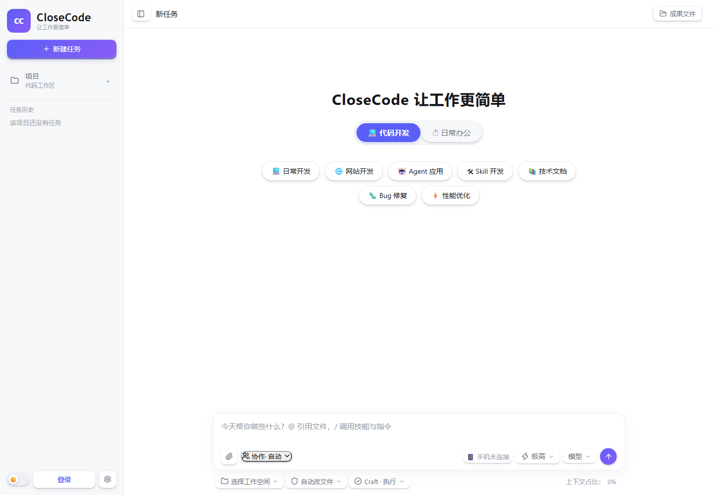

# CloseCode

**面向开发与日常办公的本地优先 AI Agent 工作台。** 用自然语言描述任务，Agent 可以结合工具、技能与专家协作完成研究、代码、文档和数据处理，并把真实文件写入工作区。

支持 Electron 桌面应用、Node.js 自托管服务和命令行入口。项目数据与成果保存在本机；使用远程模型时，对话上下文会发送给你配置的模型服务商。配置 Ollama 等本地模型可减少对远程模型 API 的依赖，但联网搜索等功能仍需要网络。

## 界面截图



截图展示主界面的新任务状态；模型和项目数据因环境配置不同而异。

## 功能概览

### Agent 工作台

- 流式对话与任务历史，按项目和工作目录组织任务。
- 支持 Ask、Plan、Craft 等任务模式；可在界面中查看执行步骤、工具结果与输出文件。
- 任务成果直接写入工作区，可查看、预览和继续处理。
- 支持长任务进度、会话记录和工作区切换。

### 多模型与可扩展工具

- 支持 Anthropic 接口与 OpenAI 兼容接口；可添加自定义模型端点。
- 可配置 OpenAI、Claude、DeepSeek、Qwen、GLM、Kimi、Ollama 等兼容服务。具体可用模型取决于服务商和你的配置。
- Agent 工具覆盖文件读写与编辑、Node.js 和 Shell 执行、网页搜索与抓取、动态网页渲染、图片查看和图表生成。
- 可生成 Word、Excel、PowerPoint、HTML、图表等成果；图片、视频和语音生成需另外配置相应模型服务。

### 技能、专家与连接器

- **技能（Skills）**：内置技能覆盖研究、编程审查、数据可视化、数据库设计、Office 文档、PDF 和网页制作等；也支持安装或管理技能包。
- **专家与专家团**：可将任务委派给单个专家，或让多位专家按顺序接力；团队成员共享任务工作区。
- **MCP 与 Agent Plugins**：可连接 MCP 服务，并通过插件扩展技能和连接器。

### 自动化与桌面能力

- 可设置定时任务，自动执行周期性工作。
- Electron 桌面版提供系统窗口、托盘和桌面宠物等桌面能力。
- 可选开启 Cloudflare Tunnel 远程控制，让手机浏览器连接本机工作台；默认不应把服务端口直接暴露到公网。

## 快速开始

### 环境要求

- Node.js **18 或更高版本**（建议使用当前 LTS 版本）。
- Git。
- 至少配置一个模型服务商。若只使用本地模型，可配置 OpenAI 兼容的本机端点，例如 Ollama。

### 1. 获取项目并安装依赖

```bash
git clone https://github.com/CatCatUncle/docode.git
cd docode
```

纯服务端运行可安装生产依赖：

```bash
npm install --omit=dev
```

运行 Electron 桌面版则需安装开发依赖：

```bash
npm install
```

### 2. 配置模型

首次启动时，项目会从 `config.example.json` 创建 `config.json`。如需手动准备配置，只在 `config.json` 尚不存在时复制，避免覆盖已有密钥与设置：

```bash
[ -f config.json ] || cp config.example.json config.json
```

在 `config.json` 的 `models` 中填写模型名称、服务类型、`base_url`、模型名和 API Key，并设置 `active_model`。也可以在应用设置中配置模型。**不要将包含真实 API Key 的 `config.json` 提交到 GitHub。**

### 3. 启动服务端

为避免在局域网或公网接口上意外开放具备 Shell 能力的 Agent，建议明确绑定回环地址。

macOS / Linux：

```bash
HOST=127.0.0.1 npm start
```

Windows PowerShell：

```powershell
$env:HOST = "127.0.0.1"; npm start
```

Windows 命令提示符：

```bat
set "HOST=127.0.0.1" && npm start
```

默认端口为 `3800`。启动后在浏览器打开：

```text
http://127.0.0.1:3800
```

端口可通过 `PORT` 环境变量或配置中的 `server.port` 修改。

### 其他启动方式

Electron 桌面版：

```bash
npm install
npm run app
```

命令行单次任务：

```bash
npm run cli -- "帮我整理一份项目周报"
```

命令行需要已有 `config.json` 和可用的模型配置。

### Docker Compose

项目提供 `Dockerfile` 与 `docker-compose.yml`。仅在 `config.json` 尚不存在时，从模板复制后填写模型配置；不要覆盖已有配置。再运行：

```bash
[ -f config.json ] || cp config.example.json config.json
docker compose up --build -d
```

Compose 示例把宿主机端口绑定到 `127.0.0.1:3800`。如需经反向代理访问，请自行配置 HTTPS、认证与访问控制；不要直接将 Agent 服务端口开放到公网。

## 安全与隐私

- `config.json` 可能包含 API Key；不要提交真实密钥、用户数据、会话记录或工作成果。
- 独立 Node 服务若未设置 `HOST`，会按配置或默认主机地址监听。只在本机使用时，请按上面的方式绑定 `127.0.0.1`。
- Agent 可执行代码和 Shell 命令。项目提供应用层审批与安全控制，但这**不是操作系统级沙箱**；不要把不可信用户直接接入开放的服务端。需要多用户或公网部署时，应使用操作系统账号隔离、容器/网络策略、HTTPS、认证与最小权限配置。
- 使用远程模型时，发给模型的提示词与相关上下文会传输给所选服务商。请在发送前确认数据处理方式符合你的要求。
- Cloudflare Tunnel 远程访问为可选功能；启用后仍应妥善保护设备绑定与访问凭证。

## 项目结构

```text
electron-main.js       Electron 桌面入口
server.js              Web 服务与 API 主入口
cli.js                 命令行入口
agent.js / llm.js      Agent 运行时与模型适配
tools.js               Agent 工具实现
lib/                   共享运行库、协议、安全与路径处理
public/                Web 工作台与静态资源
skills/                内置技能包
experts.json           专家与专家团定义
eval/                  Agent 评测程序
scripts/               图标、补丁等构建辅助脚本
```

## 开发与当前限制

- `npm start`：启动 Node.js 服务端。
- `npm run app`：启动 Electron 桌面版。
- `npm run cli -- "任务描述"`：运行 CLI。
- `npm run eval`：运行 Agent 评测。评测会调用所配置的真实模型，可能产生 API 费用。
- 当前仓库快照没有配置 `npm test` 自动化测试脚本；不要将本项目描述为已有自动化测试全绿。

## 许可证与 GitHub 发布说明

当前 `LICENSE` 使用 **PolyForm Noncommercial License 1.0.0**，仅授予符合该许可条件的非商业用途；商业用途不在该许可授权范围内。这是一种带非商业限制的许可证，**不是 OSI 批准的开源许可证**。如果你的目标是符合通常意义上的开源许可，请先确认版权归属并与权利人确认，再选择并替换为所需许可证。

此外，`COMMERCIAL-LICENSE.md` 只是商业授权说明，不是商业授权协议；联系人和邮箱目前仍是占位信息。公开发布前，请由版权持有人确认说明内容并补充真实联系渠道。

---

> 项目代码与配置仍需由维护者按实际部署环境审查；开源发布前请检查提交内容中没有密钥、个人数据、未授权资源或不适合公开的补丁签名材料。
